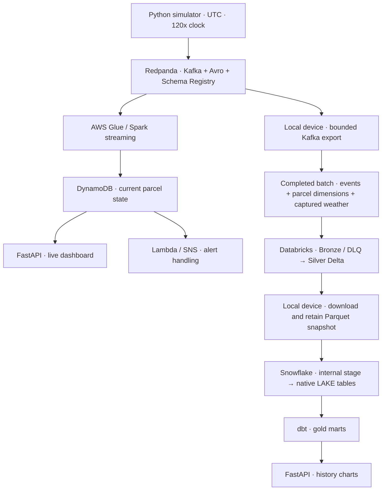

# outfordelivery

[](https://github.com/getsuga-tenshou/outfordelivery/actions/workflows/ci.yml)

A parcel delivery platform with live operations on AWS and batch analytics in Databricks and Snowflake. A Python simulator sends Avro events through Redpanda as parcels move through a Dutch delivery network. The dashboard combines current parcel state, locations and SLA risk with delivery, failure and weather analytics.

The live and analytics paths run independently. AWS Glue and DynamoDB maintain current state. Actual Kafka records are exported with parcel dimensions and captured weather, processed in Databricks, then copied through the local device into Snowflake for dbt transformations. Docker, DynamoDB Local and DuckDB provide a complete local development path.

This is a working portfolio demonstration. The local pipeline and integrated cloud route have been exercised; it is not operated as a continuously running production service.

## Architecture



Databricks owns Bronze and Silver. Snowflake holds a verified copy of both Silver datasets and builds the marts. A local coordinator handles upload, job completion, download, Snowflake loading and dbt; the device must be available for a refresh. The default `free` bundle target reads completed volume batches, disables direct Kafka/DynamoDB/Snowflake calls within Databricks and keeps schedules paused.

| Layer | Local development | Integrated cloud route |
|---|---|---|
| Event transport | Redpanda + Schema Registry in Docker | Redpanda on EC2 + Schema Registry |
| Live processing | Spark Structured Streaming | AWS Glue streaming |
| Live state | DynamoDB Local | AWS DynamoDB |
| Bronze / Silver | Delta Bronze and Parquet Silver in MinIO | Databricks Delta tables in managed storage |
| Analytics | dbt + DuckDB reading local Silver | Retained Parquet → native Snowflake tables → dbt |
| Dashboard | FastAPI, MapLibre GL and Chart.js | Same app; DynamoDB live view and Snowflake history |

Terraform provisions AWS, Databricks and Snowflake through separate roots. Databricks Asset Bundles define the processing jobs. An optional compatible-storage Iceberg mode remains in the code; the deployed and verified analytics route uses native Snowflake tables.

## What the app provides

- **Live operations:** parcel status counts, throughput by hub, locations and parcel details.
- **SLA risk:** on-time, at-risk and breached parcels on the shared simulation clock, with drill-down from cards to parcels.
- **History:** delivery funnel, on-time rate by region, failure analysis and weather impact from four dbt marts.

The simulator models eight Dutch hubs, three service levels, multiple carriers, failed deliveries, rescheduling and returns. Open-Meteo supplies live weather with an explicit synthetic fallback. Offline replay uses synthetic weather captured with its input batch.

## Run locally

Use Docker with Compose and Python **3.11 or 3.12**. GNU Make and Bash are optional; the commands below work without Make. Run commands from the repository root.

Create a virtual environment:

```sh
python -m venv .venv
```

Activate it with `source .venv/bin/activate` on Bash, or `.\.venv\Scripts\Activate.ps1` on Windows PowerShell. Then install dependencies, copy the local configuration and start the stack:

```sh
python -m pip install -r requirements-dev.txt
cp .env.example .env
docker compose --env-file .env -f docker/docker-compose.yml up -d
```

Compose starts Redpanda, its Console, MinIO, DynamoDB Local and Spark. Once Redpanda reports healthy in `docker compose --env-file .env -f docker/docker-compose.yml ps`, create topics and start a small producer run in the activated environment:

```sh
python scripts/manage_topics.py
python -m simulator.simulate --produce --max-parcels 5 --seed 42
```

In a second terminal, start the streaming consumer:

```sh
docker compose --env-file .env -f docker/docker-compose.yml exec spark-master bash /opt/outfordelivery/streaming/run.sh
```

Expect `bronze+=... dynamo_upserts=...` messages. The producer appends dimensions to `data/parcels.jsonl`; Spark reloads them to calculate live breach flags. A complete parcel lifecycle can take several wall-clock minutes. To inspect a partial run, stop the producer with Ctrl+C, allow the consumer to catch up, then stop the consumer with Ctrl+C.

Promote Bronze into Silver Parquet, build the local marts and inspect live state:

```sh
docker compose --env-file .env -f docker/docker-compose.yml exec spark-master bash /opt/outfordelivery/streaming/run_silver.sh
python scripts/run_dbt.py build
python scripts/scan_state.py
```

The dbt wrapper supplies the configured acceleration. Start the dashboard with `OFD_WAREHOUSE` unset or set to `duckdb`:

```sh
python -m uvicorn dashboard.app:app --port 8050
```

| Service | Address |
|---|---|
| Dashboard | http://localhost:8050 |
| Redpanda Console | http://localhost:8080 |
| Schema Registry | http://localhost:8081 |
| MinIO Console | http://localhost:9001 |
| Spark master UI | http://localhost:8090 |

Stop the stack while retaining containers and data volumes:

```sh
docker compose --env-file .env -f docker/docker-compose.yml stop
```

## Refresh cloud analytics from the actual stream

This workflow requires provisioned cloud resources and credentials. The producer saves parcel dimensions and immutable weather context under `data/producer_context` before sending each event; retain that directory. Point the producer and exporter at the same broker using `KAFKA_BOOTSTRAP` and `SCHEMA_REGISTRY_URL`.

Export and verify a bounded batch of actual Kafka records:

```sh
python scripts/export_redpanda_batch.py --batch-id stream-demo
python -m simulator.simulate --verify-batch data/batches/stream-demo
```

The exporter freezes end offsets per partition and commits only its reserved group, `ofd-batch-export-v1`. Live Spark/Glue consumer offsets are untouched. Completed inputs contain `events.jsonl`, `parcels.jsonl`, `weather.json`, `manifest.json` and `COMPLETE`. Counts, checksums, acceleration and source offsets are verified together. Use a new batch ID for a new range; retry the same ID after an interruption.

After deploying the `free` bundle, find the pipeline job ID with `databricks bundle summary -t free --profile ofd`. Start one coordinated refresh from an existing completed manifest:

```sh
python scripts/sync_snowflake.py sync --manifest data/batches/stream-demo/manifest.json --export-id stream-snapshot --job-id <pipeline-job-id> --profile ofd
```

Replace `ofd` with your configured Databricks profile. The coordinator:

1. Uploads and verifies the paired input in a managed volume.
2. Runs parcel/weather ingestion, Bronze validation and DLQ routing, Silver processing, optimization and snapshot export in Databricks.
3. Downloads and retains both Silver Parquet datasets and their versioned manifest under `data/exports/<export-id>/`.
4. Verifies the saved files, stages them in Snowflake, and publishes both native tables plus a successful load-audit row in one transaction.
5. Runs dbt source freshness and builds the Snowflake marts.

For an interrupted refresh, use `resume`. To load an already verified device export without contacting Databricks, use `load`:

```sh
python scripts/sync_snowflake.py resume --export-id stream-snapshot --profile ofd
python scripts/sync_snowflake.py load --export-id stream-snapshot
```

Neither command regenerates input. Keep input batches, producer context, managed/device exports, `data/exports/.runs/` state, the validation ledger and checkpoints. A snapshot fixes both Silver table versions; a repeated load is a no-op, and an older snapshot cannot replace newer published source versions. Freshness uses the successful load-audit timestamp, with a one-hour warning and 24-hour error threshold, independently of historical event timestamps.

To generate a separate offline replay fixture with synthetic weather:

```sh
python -m simulator.simulate --sink files --batch-id replay-demo --count 10 --seed 42
python -m simulator.simulate --verify-batch data/batches/replay-demo
```

## Configuration and deployment

| Location | Purpose |
|---|---|
| [`config/`](config/) | Hubs, service levels, SLA hours, acceleration, arrivals, failures and weather |
| [`.env.example`](.env.example) | Local defaults and environment/credential placeholders |
| [`infra/`](infra/) | AWS broker, lake, Glue, DynamoDB, Athena infrastructure and Lambda/SNS |
| [`infra/databricks/`](infra/databricks/) | Managed catalog, schemas and raw/checkpoint/export volumes |
| [`databricks.yml`](databricks.yml) | Bundle targets, runtime and integration flags |
| [`infra/snowflake/`](infra/snowflake/) | Native LAKE tables, stage, roles, users and warehouse controls |
| [`dbt/`](dbt/) | Shared models with DuckDB/Snowflake adapter dispatch |
| [`Makefile`](Makefile) | Local, batch, bundle and transfer command shortcuts |

Review each Terraform root and its `terraform.tfvars.example` separately. AWS has an account-ID guard. For managed Databricks storage, [`bootstrap_catalog.sql`](infra/databricks/bootstrap_catalog.sql) provides the SQL catalog bootstrap; import a pre-created catalog and preserve its actual storage metadata before applying remaining resources. Use `source_mode = "native"` for Snowflake and separate public keys for `OFD_LOADER`, `OFD_DBT` and `OFD_DASHBOARD`. Keep private keys and actual tfvars outside committed files. Deploy the reviewed bundle with `databricks bundle deploy -t free --profile ofd`. Cloud usage and retained storage can incur costs.

Compose and the simulator, dbt runner, bounded exporter and Snowflake coordinator read `.env`; existing shell variables take precedence in the Python loader. Uvicorn and the Databricks CLI need settings exported explicitly. Transfers require `SNOWFLAKE_ACCOUNT` and separate loader/dbt keys. For Snowflake history, export `OFD_WAREHOUSE=snowflake` and the dashboard's `OFD_SF_*` settings from `.env.example`; its reader role has access only to marts.

Live serving defaults to DynamoDB Local. For real AWS, set `OFD_DDB_TABLE`, `AWS_REGION`, your AWS profile and matching `OFD_PARCELS_PATH`, and remove exported dummy Local credentials. An empty `OFD_DDB_ENDPOINT` selects the AWS credential chain; an unset value selects Local. Windows PowerShell 5.1 removes empty environment variables, so this launcher sets the empty endpoint inside the process:

```sh
python -c "import os, uvicorn; os.environ['OFD_DDB_ENDPOINT'] = ''; uvicorn.run('dashboard.app:app', port=8050)"
```

## Clock and recovery contracts

- **One clock:** UTC event timestamps, simulated SLA hours and a declared acceleration, currently **120x**. Wall-clock deadlines are `created_at + sla_hours * 3600 / acceleration`. Batch validation and the dbt wrapper reject a conflicting factor.
- **Event correctness:** Avro contracts, valid hubs/geography, five-minute future-time tolerance, event-ID deduplication and version-conditional live-state updates. Invalid records go to the DLQ.
- **Required context:** paired events, parcel dimensions and captured weather. Missing coverage, corrupt files and incomplete markers block publication. Explicit unknown weather remains null.
- **Recoverable transfer:** immutable input IDs, bounded offsets, checksummed files, frozen Delta versions, saved run state, transactional Snowflake publication and idempotent retries.

## Verification and CI

The complete local path was verified with **246 valid events, one rejected unknown-hub event and 118 parcels**. Bronze and Silver event-ID sets matched the frozen broker capture; DuckDB/dbt passed **27/27**; eight live/history endpoints and all four browser history charts passed. Exact-deadline, one-millisecond-late and terminal fixtures produced the expected live breach flags at 120x.

The integrated cloud run verified a **132-event / 22-parcel** snapshot, exact saved-Parquet/native-table equality, Snowflake/DuckDB mart parity, retries and a combined dashboard. AWS live updates continued while the Snowflake warehouse was suspended. These are recorded verification results, not ongoing service availability.

After installing `requirements-dev.txt`, run the offline checks:

```sh
python -m ruff check .
python scripts/validate_schemas.py
python -m pytest -q
```

The latest host and clean Linux suites passed **142 tests with four optional broker/Spark checks skipped**. Separate real Redpanda and Spark/Delta runs exercised the integrations, including independent consumer offsets and interrupted export recovery at a non-default acceleration.

The [GitHub Actions workflow](.github/workflows/ci.yml) has four jobs: lint/schema/tests and both dbt parses; an actual Redpanda handoff test; offline Databricks bundle schemas; and mocked native/optional Iceberg Terraform plans. All four jobs passed on `main`. Workspace-dependent bundle validation runs only when both workspace secrets are available; it was skipped in the verified run.

## Current limits

- Local Spark calculates event-time breach flags from parcel dimensions. The deployed Glue route still lacks that lookup and weather enrichment, so AWS SLA breach alerts are incomplete. A silent-parcel sweep is unimplemented, and SNS email delivery is unverified.
- The CARTO basemap displays an API-key notice. Parcel coordinates and the live location API work.
- `--duration` does not reliably bound a busy producer. Use `--max-parcels`, or stop manually with Ctrl+C.
- Analytics refresh is coordinated from the device; there is no permanent scheduler spanning all platforms. History remains at the last successful snapshot while live serving continues independently.
- At the last recorded shutdown on **2026-10-25**, EC2/Glue were stopped, Databricks schedules were paused, its SQL warehouse was stopped and Snowflake was suspended. An EC2 broker restart needs its new public IP, allowlist and advertised external listener checked; the existing container retains its first-boot address. Retained storage can still incur costs. Snowflake trial/credit expiry is separate from credential expiry.
