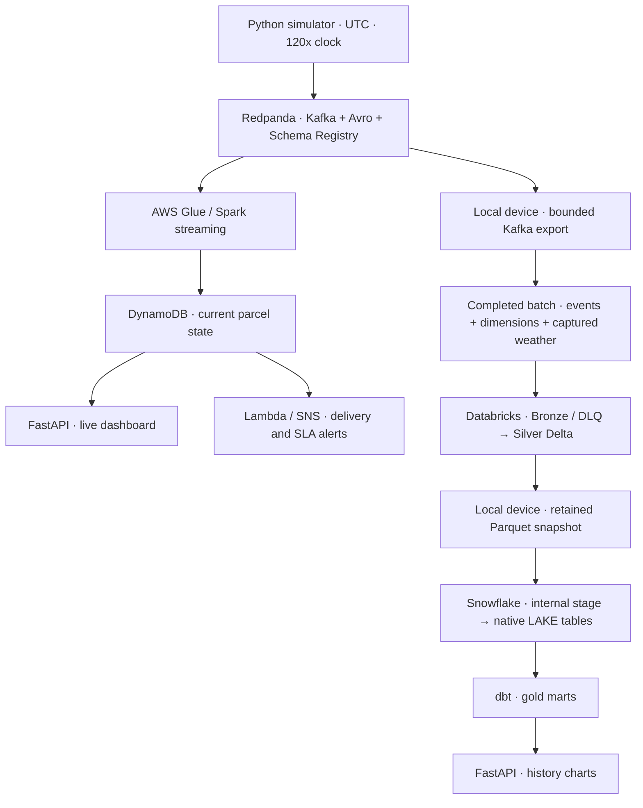

# outfordelivery

[](https://github.com/getsuga-tenshou/outfordelivery/actions/workflows/ci.yml)

A parcel delivery platform with live operations on AWS and batch analytics in Databricks and Snowflake. A Python simulator sends Avro events through Redpanda as parcels move through a Dutch delivery network. A FastAPI dashboard shows parcel locations, status, SLA risk and delivery analytics.

The live and analytics paths operate independently. Glue updates current parcel state in DynamoDB. Actual Kafka records, parcel dimensions and captured weather are exported as a completed batch, processed in Databricks, then copied through the local device into Snowflake for dbt transformations. Docker, DynamoDB Local and DuckDB provide a local development path.

This is a portfolio demonstration, operated through deliberate producer runs and analytics refreshes.

## Architecture



Databricks owns Bronze and Silver. Snowflake holds a verified copy of both Silver datasets and builds the marts. A device coordinator handles input upload, processing completion, snapshot download, Snowflake loading and dbt. A daily Windows task can run that coordinator for new completed actual-stream batches.

| Layer | Local development | Cloud route |
|---|---|---|
| Event transport | Redpanda + Schema Registry in Docker | Redpanda + Schema Registry on EC2 |
| Live processing | Spark Structured Streaming | AWS Glue streaming |
| Live state | DynamoDB Local | AWS DynamoDB |
| Bronze / Silver | Delta Bronze and Parquet Silver in MinIO | Databricks Delta tables in managed storage |
| Analytics | dbt + DuckDB | Retained Parquet → native Snowflake tables → dbt |
| Dashboard | FastAPI, MapLibre GL and Chart.js | Same app with DynamoDB live data and Snowflake history |

## What it contains

- **Delivery simulation:** eight Dutch hubs, three service levels, multiple carriers, failed deliveries, rescheduling and returns. Open-Meteo supplies live weather with an explicit synthetic fallback.
- **Live operations:** parcel status counts, hub throughput, map locations, parcel details and SLA risk with drill-down views.
- **Analytics:** delivery funnel, on-time rate by region, failure analysis and weather impact across four dbt marts.
- **Stream validation:** Avro contracts, hub/geography checks, event-ID deduplication, a dead-letter path and version-conditional state updates.
- **Recoverable transfers:** paired input manifests, captured weather, bounded Kafka offsets, checksums, frozen Silver versions, retained device exports and transactional Snowflake publication.
- **Infrastructure and automation:** separate Terraform roots for AWS, Databricks and Snowflake; Databricks Asset Bundles; a Windows coordinator task; tests and GitHub Actions.

| Directory | Contents |
|---|---|
| [`simulator/`](simulator/) | Parcel journeys, event production, weather and captured producer context |
| [`schemas/`](schemas/) | Avro event and dimension contracts |
| [`streaming/`](streaming/) | Local Spark and Glue processing, shared rules and snapshot loading |
| [`databricks/`](databricks/) | Bronze/Silver jobs, validation and snapshot export |
| [`dbt/`](dbt/) | Shared models with DuckDB/Snowflake adapter dispatch |
| [`dashboard/`](dashboard/) | Live API, map and history charts |
| [`infra/`](infra/) | Terraform resources and alert handling |
| [`scripts/`](scripts/) | Topic setup, batch export, transfer, scheduling and validation commands |
| [`config/`](config/) | Network, SLA, simulation and weather settings |
| [`docker/`](docker/) | Local Compose services |
| [`tests/`](tests/) | Unit tests and optional broker/Spark integration checks |

## Run locally

Use Python **3.11 or 3.12** and Docker with Compose. Run commands from the repository root. GNU Make is optional; [`Makefile`](Makefile) provides shortcuts for the same operations.

Create a virtual environment:

```sh
python -m venv .venv
```

Activate it with `source .venv/bin/activate` on Bash or `.\.venv\Scripts\Activate.ps1` on Windows PowerShell. Install dependencies and, on first setup, copy [`.env.example`](.env.example) to `.env`:

```sh
python -m pip install -r requirements-dev.txt
cp .env.example .env
docker compose --env-file .env -f docker/docker-compose.yml up -d
```

Set `CARTO_MAP_API_KEY` in `.env` to enable the dashboard basemap. The local data pipeline can run without that key.

Compose starts Redpanda, its Console, MinIO, DynamoDB Local and Spark. Once Redpanda reports healthy in `docker compose --env-file .env -f docker/docker-compose.yml ps`, create topics and produce a small run:

```sh
python scripts/manage_topics.py
python -m simulator.simulate --produce --max-parcels 5 --seed 42
```

In another terminal, start the streaming consumer:

```sh
docker compose --env-file .env -f docker/docker-compose.yml exec spark-master bash /opt/outfordelivery/streaming/run.sh
```

The producer saves dimensions to `data/parcels.jsonl` and immutable event/weather context to `data/producer_context/`. The consumer reports `bronze+=... dynamo_upserts=...`. Parcel journeys can take several wall-clock minutes. After the producer finishes and the consumer catches up, stop the consumer with Ctrl+C, then build Silver and the local marts:

```sh
docker compose --env-file .env -f docker/docker-compose.yml exec spark-master bash /opt/outfordelivery/streaming/run_silver.sh
python scripts/run_dbt.py build
python scripts/scan_state.py
python -m uvicorn dashboard.app:app --port 8050
```

The dashboard defaults to DuckDB history. Keep `OFD_WAREHOUSE` unset or set to `duckdb` for this local path.

| Service | Address |
|---|---|
| Dashboard | http://localhost:8050 |
| Redpanda Console | http://localhost:8080 |
| Schema Registry | http://localhost:8081 |
| MinIO Console | http://localhost:9001 |
| Spark master UI | http://localhost:8090 |

Stop the stack while retaining containers and data volumes:

```sh
docker compose --env-file .env -f docker/docker-compose.yml stop
```

## Run the cloud route

Cloud operation requires provisioned resources, network access and credentials. Review the separate Terraform roots under [`infra/`](infra/), [`infra/databricks/`](infra/databricks/) and [`infra/snowflake/`](infra/snowflake/), using their example tfvars. AWS has an account-ID guard. The Databricks managed-catalog bootstrap is in [`bootstrap_catalog.sql`](infra/databricks/bootstrap_catalog.sql). Use `source_mode = "native"` for the documented Snowflake route, with separate keys for the loader, dbt and dashboard roles. Keep actual tfvars, private keys and credentials outside committed files.

Configure a Databricks CLI profile and deploy the `free` bundle target:

```sh
databricks bundle validate -t free --profile ofd
databricks bundle deploy -t free --profile ofd
databricks bundle summary -t free --profile ofd
```

Replace `ofd` with your profile. This target reads completed volume batches, keeps cloud schedules paused and runs Snowflake/dbt coordination on the device. Record the pipeline job ID from the bundle summary.

### Live AWS serving

Point `KAFKA_BOOTSTRAP` and `SCHEMA_REGISTRY_URL` at the provisioned broker and use the producer command above. Upload the producer's `data/parcels.jsonl` and `data/weather_cache.json` to the Terraform outputs `parcel_dimension_uri` and `weather_cache_uri`; Glue reloads them each micro-batch for SLA and weather enrichment.

For the dashboard, export `OFD_DDB_TABLE`, `AWS_REGION`, your AWS profile and a matching `OFD_PARCELS_PATH`. Remove any exported dummy local AWS credentials. Set `OFD_DDB_ENDPOINT` to an empty string for real AWS; an unset value selects DynamoDB Local. On Windows PowerShell 5.1, use this launcher because the shell removes empty environment variables:

```sh
python -c "import os, uvicorn; os.environ['OFD_DDB_ENDPOINT'] = ''; uvicorn.run('dashboard.app:app', port=8050)"
```

### Refresh analytics

Keep the producer context and point the exporter at the same broker as the producer. Export a bounded batch of actual Kafka records:

```sh
python scripts/export_redpanda_batch.py --batch-id stream-demo
python -m simulator.simulate --verify-batch data/batches/stream-demo
```

Each completed batch contains events, parcel dimensions, captured weather, a manifest and a `COMPLETE` marker. The exporter freezes end offsets and commits only its reserved consumer group; live Spark/Glue offsets are untouched. Use a new batch ID for a new range, and reuse the same ID after interruption.

Set `SNOWFLAKE_ACCOUNT`, the loader key settings and the separate dbt key/user settings from `.env.example`. Replace `<pipeline-job-id>` below with the deployed job ID:

```sh
python scripts/sync_snowflake.py sync --manifest data/batches/stream-demo/manifest.json --export-id stream-snapshot --job-id <pipeline-job-id> --profile ofd
```

The coordinator uploads the input, runs Databricks processing/export, downloads both Silver Parquet datasets to `data/exports/<export-id>/`, publishes them into Snowflake and runs dbt freshness/build. Resume an interrupted transfer with the same export ID; load an already verified device export without contacting Databricks:

```sh
python scripts/sync_snowflake.py resume --export-id stream-snapshot --profile ofd
python scripts/sync_snowflake.py load --export-id stream-snapshot
```

Retries preserve input and run identity. Repeated successful publication is a no-op and does not reset the load-audit timestamp. A failed Databricks run needs inspection/repair under its original run ID. Retain inputs, producer context, snapshots, `.plans`/`.runs`, validation history and checkpoints for recovery.

For dashboard history, export `OFD_WAREHOUSE=snowflake` and the `OFD_SF_*` reader settings from `.env.example` before launching Uvicorn. Live state continues to come from DynamoDB.

### Daily Windows scheduling

Initialize the scheduler once, then install its daily task from PowerShell. The interpreter below matches the `.venv` environment created in the local setup:

```powershell
python scripts/schedule_sync.py init --job-id <pipeline-job-id> --profile ofd
.\scripts\install_sync_schedule.ps1 -Action Install -IntervalMinutes 1440 -Python .venv/Scripts/pythonw.exe
```

Initialization excludes all existing batch IDs. Export new actual-stream batches after initialization for automatic pickup; Kafka export remains a separate step. Each daily check processes at most one completed batch, oldest first. Replay fixtures and partial batches are ignored, and empty captures start no analytics compute. Failed/interrupted work retries the same export/run before newer work.

The task runs in the background while its installing user is logged in and the device is awake. It does not wake the device; missed checks start when available. Keep `data/scheduler/config.json`, `state.json` and attempt logs together with the coordinator state. Missing or conflicting state stops processing.

```powershell
python scripts/schedule_sync.py status
.\scripts\install_sync_schedule.ps1 -Action Status
.\scripts\install_sync_schedule.ps1 -Action Disable
.\scripts\install_sync_schedule.ps1 -Action Enable
```

Disable pauses future checks without interrupting a running transfer. The installer defaults to `venv/Scripts/pythonw.exe` if `-Python` is omitted. `SetInterval -IntervalMinutes 1440`, with the matching `-Python` and `-Config` settings, sets a daily interval for an existing matching task. Manual coordinator commands remain available.

## Configuration and checks

The simulator uses UTC timestamps, simulated SLA hours and a shared acceleration factor from [`config/simulation.yaml`](config/simulation.yaml), currently **120x**. Wall-clock SLA deadlines are `created_at + sla_hours * 3600 / acceleration`. Batch validation and the dbt wrapper reject conflicting factors.

Compose and the simulator, export, transfer, scheduling and dbt Python commands read `.env`; existing shell variables take precedence in the Python loader. The dashboard reads the CARTO key directly from `.env`, with shell precedence. Other Uvicorn settings and the Databricks CLI require exported variables.

To generate a separate offline replay fixture with captured synthetic weather:

```sh
python -m simulator.simulate --sink files --batch-id replay-demo --count 10 --seed 42
python -m simulator.simulate --verify-batch data/batches/replay-demo
```

Run the offline checks after installing `requirements-dev.txt`:

```sh
python -m ruff check .
python scripts/validate_schemas.py
python -m pytest -q
```

Real broker/Spark integration tests are opt-in. [GitHub Actions](.github/workflows/ci.yml) runs lint, schemas, tests, both dbt parses, a Redpanda handoff check, bundle schemas and mocked Snowflake Terraform plans. Authenticated bundle validation requires the repository secrets `DATABRICKS_HOST` and `DATABRICKS_TOKEN`; it validates configuration without deploying the pipeline.

## Limitations

- **Analytics depends on the device.** Kafka export is explicit, and the daily Windows task requires its user to be logged in and the device awake. It handles one batch per check, so multiple waiting batches create a backlog. History shows the last successful refresh while live serving continues independently.
- **Alerts are event-driven.** Glue/Spark calculate breach flags when events arrive. Lambda/SNS alerts when `breached` changes to true and on every RETURNED update. A parcel that stops emitting events can pass its SLA without an email. Dashboard SLA recalculation sends no alert; the daily maintenance tick does not scan silent parcels.
- **Standalone jobs must run separately from the processing DAG.** Per-job limits and device/publication locks do not provide a global lock across all Databricks jobs. Keep the cloud schedules paused for the documented device-coordinated route.
- **AWS enrichment uses uploaded context.** Missing parcel dimensions prevent a reliable live breach calculation. Weather uses the latest uploaded cache with no staleness cutoff; missing/unknown observations remain null. Batch analytics uses its captured per-event weather instead.
- **The basemap needs a CARTO key.** Without it, parcel points remain usable on a plain background. The browser sends the configured key to CARTO for tile requests.
- **Simulation duration is an admission limit.** `--duration` stops creating new parcels, then drains their queued events and flushes Kafka. Total runtime can exceed the requested duration. `--max-parcels` also drains admitted journeys; Ctrl+C interrupts the drain.
- **Cloud availability and retained storage matter.** Credentials and accounts must remain usable for transfers. Stopped compute can still leave chargeable storage and logs. After an EC2 stop/start, recheck the broker's public IP, device allowlist and Kafka metadata before producing or exporting.
